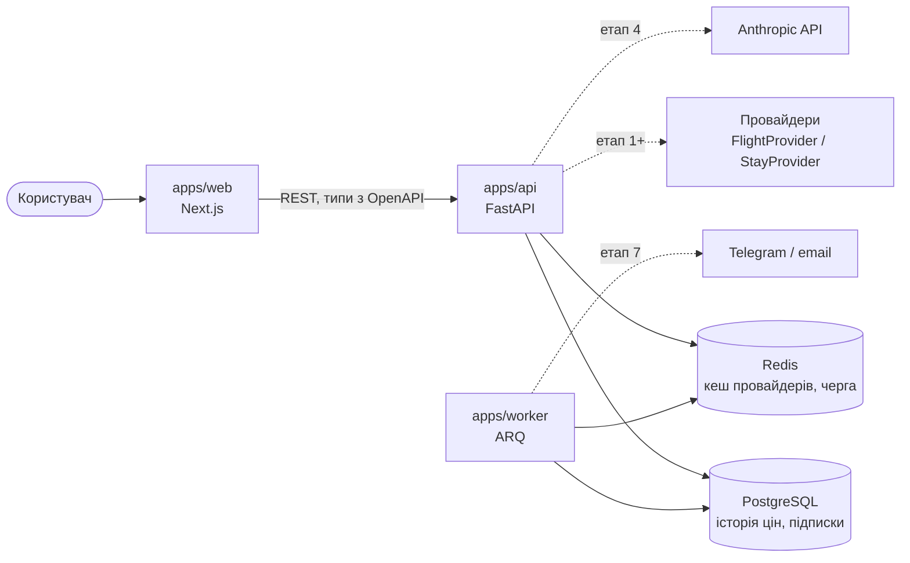
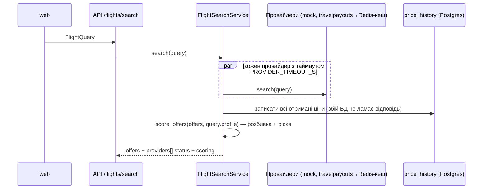

# Архітектура

## Шари backend (`tickets_api`)

| Пакет | Відповідальність |
|---|---|
| `api/` | HTTP-роутери, лише перетворення запит/відповідь |
| `core/` | конфіг (pydantic-settings), логування (structlog), Sentry |
| `db/` | SQLAlchemy `Base` з naming convention, фабрики engine/session |
| `domain/` | `FlightQuery`, `Offer`, `Leg`, `Segment`, `Layover`, `CalendarDay`. Без I/O |
| `providers/` | `FlightProvider` (інтерфейс), `mock`, `travelpayouts`, `cached` (Redis-кеш), `registry` |
| `scoring/` | детермінований скоринг і Pareto-вибірка (cheapest / fastest / balanced), ваги в `config.toml` |
| `services/` | `FlightSearchService`: паралельне опитування з таймаутом, graceful degradation, скоринг |
| `repositories/` | `price_history`: пакетний запис кожної отриманої ціни |

Воркер імпортує `tickets_api` як бібліотеку (uv workspace), тож моделі, провайдери й
конфіг спільні, без дублювання.

## Health-checks

- `GET /health` (liveness): процес живий, залежності не перевіряються.
- `GET /health/ready` (readiness): паралельно перевіряє Postgres (`SELECT 1`) і Redis
  (`PING`) з таймаутом `READINESS_TIMEOUT_S`. Будь-яка помилка залежності дає
  503 `degraded` з назвою помилки, а не 500.

## Контракт API ↔ web

Pydantic-моделі → OpenAPI (`python -m tickets_api.openapi`) → `openapi-typescript` →
`packages/shared/src/api.gen.ts`. Згенерований файл комітиться. CI-джоба `contract`
падає, якщо його забули оновити.

## Пошук перельотів (етап 1)

- Провайдери вмикаються через `FLIGHT_PROVIDERS` (за замовчуванням `mock`).
- `Offer.price` — ціна за одного дорослого. `collected_at` — коли ціну отримали ми,
  `found_at` — коли її зафіксував провайдер (для Travelpayouts v3 невідомо).
- `details_level="summary"` означає, що деталі пересадок невідомі (`layovers=None`). Див. ADR 0004.
- Історія цін: унікальність `(source, observation_key, collected_at)`, тому та сама
  ціна, повернута з кешу, не дублюється.
