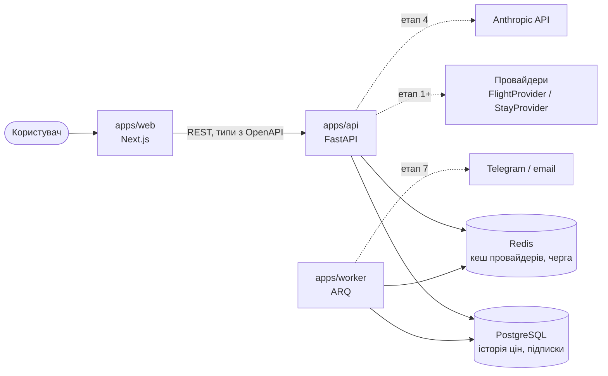

# Архітектура

## Шари backend (`tickets_api`)

| Пакет | Відповідальність |
|---|---|
| `api/` | HTTP-роутери, лише перетворення запит/відповідь |
| `core/` | конфіг (pydantic-settings), логування (structlog), Sentry |
| `db/` | SQLAlchemy `Base` з naming convention, фабрики engine/session |
| `domain/` *(етап 1)* | моделі `Offer`, `Stay`, скоринг. Чистий код без I/O |
| `providers/` *(етап 1)* | адаптери провайдерів за спільним інтерфейсом |

Воркер імпортує `tickets_api` як бібліотеку (uv workspace), тож моделі, провайдери й
конфіг спільні, без дублювання.

## Health-checks

- `GET /health` (liveness): процес живий, залежності не перевіряються.
- `GET /health/ready` (readiness): паралельно перевіряє Postgres (`SELECT 1`) і Redis
  (`PING`) з таймаутом `READINESS_TIMEOUT_S`. Будь-яка помилка залежності дає
  503 `degraded` з назвою помилки, а не 500.

## Контракт API ↔ web

Pydantic-моделі → OpenAPI (`python -m tickets_api.openapi`) → `openapi-typescript` →
`packages/shared/src/api.gen.ts`. Згенерований файл комітиться. CI-джоба `contract`
падає, якщо його забули оновити.
